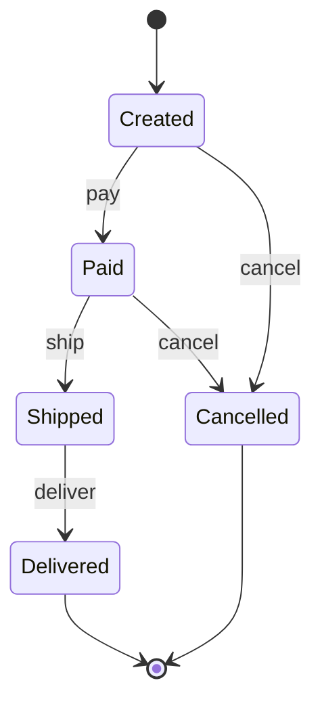

# ✍️ K3 Exercises — CTFL v4.0.1

**English** | [Português](k3-exercises.pt-BR.md)

The exam has **8 K3 questions** (apply), all in chapters 4 and 5. Each exercise below matches a K3 learning objective of the v4.0.1 syllabus. At the end there is a white-box bonus, which is K2.

**How to use:** try to solve each one before opening the answer (▶ **Show answer**).

| # | Objective | Technique |
|---|---|---|
| 1 | FL-4.2.1 | [Equivalence partitioning](#1-equivalence-partitioning-fl-421) |
| 2 | FL-4.2.2 | [Boundary value analysis (2-value and 3-value)](#2-boundary-value-analysis-fl-422) |
| 3 | FL-4.2.3 | [Decision table testing](#3-decision-table-testing-fl-423) |
| 4 | FL-4.2.4 | [State transition testing](#4-state-transition-testing-fl-424) |
| 5 | FL-4.5.3 | [ATDD](#5-atdd-fl-453) |
| 6 | FL-5.1.4 | [Effort estimation](#6-effort-estimation-fl-514) |
| 7 | FL-5.1.5 | [Test case prioritization](#7-test-case-prioritization-fl-515) |
| 8 | FL-5.5.1 | [Defect report](#8-defect-report-fl-551) |
| ⭐ | FL-4.3.1 / 4.3.2 | [Bonus: statement and branch coverage](#-bonus-statement-and-branch-coverage-fl-431--432) |

---

## 1. Equivalence partitioning (FL-4.2.1)

**1a.** A sign-up form accepts **whole-number ages from 18 to 65**. What are the partitions, and what is the minimum number of test cases for 100% coverage?

<details>
<summary>▶ Show answer</summary>

| Partition | Values | Type |
|---|---|---|
| P1 | ≤ 17 | invalid |
| P2 | 18 to 65 | valid |
| P3 | ≥ 66 | invalid |

**Minimum: 3 test cases**, one value from each partition, for example 10, 30 and 70.

Coverage is the number of partitions exercised divided by the total number of partitions: 3/3 = 100%. Invalid partitions should be tested **in isolation**, one per test case, to avoid defect masking.
</details>

**1b.** A checkout has two fields: **payment method** (PIX, card, bank slip) and **customer type** (new, returning). What is the minimum number of test cases for **Each Choice** coverage?

<details>
<summary>▶ Show answer</summary>

**3 test cases.** Each Choice requires every partition of every set to appear at least once, without combining all of them. The largest set has 3 partitions, so:

| Case | Payment | Customer |
|---|---|---|
| TC1 | PIX | new |
| TC2 | card | returning |
| TC3 | bank slip | new (or returning) |

Testing **every combination** would take 3 × 2 = 6 cases, but Each Choice coverage does not require it.
</details>

---

## 2. Boundary value analysis (FL-4.2.2)

Same field as exercise 1a: whole-number age from **18 to 65**.

**2a.** Which values are needed for 100% coverage with **2-value BVA**?

<details>
<summary>▶ Show answer</summary>

The **boundary values** are the minimum and maximum of each partition: **17** (maximum of P1), **18** and **65** (P2) and **66** (minimum of P3).

In 2-value BVA, each boundary has 2 coverage items: itself and its closest neighbor in the adjacent partition. Since the neighbors here are also boundaries, the coverage items are **17, 18, 65 and 66**, that is, **4 values**.
</details>

**2b.** And with **3-value BVA**?

<details>
<summary>▶ Show answer</summary>

In 3-value BVA, each boundary has 3 coverage items: itself and **both** of its neighbors.

| Boundary | Items |
|---|---|
| 17 | 16, 17, 18 |
| 18 | 17, 18, 19 |
| 65 | 64, 65, 66 |
| 66 | 65, 66, 67 |

Without duplicates: **16, 17, 18, 19, 64, 65, 66, 67**, that is, **8 values**.

3-value BVA is more rigorous. The syllabus gives this example: if the decision `if (x ≤ 10)` is incorrectly implemented as `if (x = 10)`, the 2-value BVA values (10 and 11) do not detect the defect. The value 9, which comes from 3-value BVA, does.
</details>

---

## 3. Decision table testing (FL-4.2.3)

**Login rule:** if the account is **locked**, the system shows "Account locked", regardless of the password. If it is not locked, the correct password logs the user in and a wrong password shows "Invalid password".

**3a.** Build the full decision table. **3b.** Minimize it. How many test cases are needed for 100% coverage of the minimized table?

<details>
<summary>▶ Show answer</summary>

**3a. Full table** (2 conditions → 2² = 4 rules):

| | R1 | R2 | R3 | R4 |
|---|:---:|:---:|:---:|:---:|
| **C1:** Account locked? | T | T | F | F |
| **C2:** Correct password? | T | F | T | F |
| **A1:** Show "Account locked" | X | X | | |
| **A2:** Log in | | | X | |
| **A3:** Show "Invalid password" | | | | X |

**3b. Minimized table.** R1 and R2 have the same action and differ only in C2, so C2 is irrelevant when the account is locked ("–"):

| | R1 | R2 | R3 |
|---|:---:|:---:|:---:|
| **C1:** Account locked? | T | F | F |
| **C2:** Correct password? | – | T | F |
| **A1:** Show "Account locked" | X | | |
| **A2:** Log in | | X | |
| **A3:** Show "Invalid password" | | | X |

**3 test cases**, one per feasible column. Coverage is the number of exercised columns divided by the total number of feasible columns.
</details>

---

## 4. State transition testing (FL-4.2.4)

**Order lifecycle:**



Every test case starts at **Created**. Answer:

**4a.** Minimum number of test cases for 100% **all states** coverage?
**4b.** Minimum for 100% **valid transitions (0-switch)** coverage?
**4c.** How many **invalid transitions** are there in the state table?

<details>
<summary>▶ Show answer</summary>

**4a. 2 cases.**
- TC1: Created → Paid → Shipped → Delivered (4 states).
- TC2: Created → Cancelled (the 5th state).

**4b. 3 cases.** There are 5 valid transitions: pay, cancel (from Created), ship, cancel (from Paid) and deliver. Since Delivered and Cancelled are final states, each case ends in one of them:
- TC1: Created →pay→ Paid →ship→ Shipped →deliver→ Delivered
- TC2: Created →cancel→ Cancelled
- TC3: Created →pay→ Paid →cancel→ Cancelled

**4c. 15 invalid transitions.** The state table has 5 states × 4 events = 20 cells. Of these, 5 are valid, so 20 − 5 = 15 are invalid (for example, "ship" from Created).

| State \ Event | pay | cancel | ship | deliver |
|---|---|---|---|---|
| Created | Paid | Cancelled | — | — |
| Paid | — | Cancelled | Shipped | — |
| Shipped | — | — | — | Delivered |
| Delivered | — | — | — | — |
| Cancelled | — | — | — | — |

For **all transitions** coverage, every invalid transition must be attempted, preferably **one per test case**, to avoid defect masking.
</details>

---

## 5. ATDD (FL-4.5.3)

**User story:** *As a customer, I want to apply a discount coupon in the cart so that I pay less.*

**Acceptance criteria:**
- The coupon `PROMO10` gives a 10% discount.
- An expired coupon shows "Coupon expired" and does not change the total.
- Only one coupon can be applied per order.

Write the acceptance test cases in the Given/When/Then format.

<details>
<summary>▶ Show answer</summary>

```gherkin
Scenario: Valid coupon applies a 10% discount
  Given a cart with a total of R$ 200.00
  When the customer applies the coupon "PROMO10"
  Then the total becomes R$ 180.00

Scenario: Expired coupon does not change the total
  Given a cart with a total of R$ 200.00
  And the coupon "SUMMER23" is expired
  When the customer applies the coupon "SUMMER23"
  Then the system shows "Coupon expired"
  And the total remains R$ 200.00

Scenario: Second coupon is rejected
  Given a cart with the coupon "PROMO10" already applied
  When the customer tries to apply another valid coupon
  Then the second coupon is not applied
```

In ATDD, tests are written **before** the implementation, from the acceptance criteria. Positive scenarios come first, then negative ones, and every criterion should have at least one test.
</details>

---

## 6. Effort estimation (FL-5.1.4)

**6a. Three-point.** The experts estimate the testing of a feature as: optimistic **a = 6**, most likely **m = 12** and pessimistic **b = 24** person-hours. Calculate the estimate and the standard deviation.

<details>
<summary>▶ Show answer</summary>

- E = (a + 4m + b) / 6 = (6 + 48 + 24) / 6 = 78 / 6 = **13**
- SD = (b − a) / 6 = (24 − 6) / 6 = **3**

**Result: 13 ± 3 person-hours**, that is, between 10 and 16 person-hours.
</details>

**6b. Ratios.** In the previous project, the ratio between development and test effort was **5:2**. The new project expects **500 person-days** of development. What is the test estimate?

<details>
<summary>▶ Show answer</summary>

500 × 2/5 = **200 person-days** of testing.
</details>

---

## 7. Test case prioritization (FL-5.1.5)

| Case | Priority (1 = highest) | Depends on |
|---|:---:|---|
| TC-A | 1 | TC-C |
| TC-B | 2 | — |
| TC-C | 3 | — |
| TC-D | 4 | TC-B |

In what order should the cases be executed?

<details>
<summary>▶ Show answer</summary>

**TC-C → TC-A → TC-B → TC-D**

TC-A has the highest priority, but it depends on TC-C, so TC-C must run first even though its priority is lower. TC-B comes next, as the next highest priority. TC-D runs last, since it depends on TC-B, which has already run.
</details>

---

## 8. Defect report (FL-5.5.1)

While testing the coupon from exercise 5, you apply `PROMO10` to a R$ 200.00 cart and the total becomes **R$ 190.00**. Write the defect report.

<details>
<summary>▶ Show answer</summary>

| Field | Content |
|---|---|
| **ID** | BUG-042 |
| **Title** | Coupon PROMO10 applies a 5% discount instead of 10% |
| **Date / author** | 2026-11-14 — tester name (QA) |
| **Test object and environment** | Cart, build 1.4.2, staging, Chrome 130 |
| **Context** | Test case TC-COUPON-01 (ATDD, "Valid coupon" scenario) |
| **Steps to reproduce** | 1. Add products totaling R$ 200.00 to the cart · 2. Apply the coupon PROMO10 |
| **Expected result** | Total of R$ 180.00 |
| **Actual result** | Total of R$ 190.00 |
| **Severity** | High (financial impact and impact on customer trust) |
| **Priority** | High (the campaign starts next week) |
| **Status** | Open |
| **References** | User story "Discount coupon", TC-COUPON-01, screenshot attached |

Remember: **severity** is the degree of impact, and **priority** is the urgency of the fix. They are independent of each other.
</details>

---

## ⭐ Bonus: statement and branch coverage (FL-4.3.1 / 4.3.2)

This bonus is K2: the exam asks you to **explain** these concepts, not to calculate them. Still, the example helps fix the difference.

```javascript
function calculateShipping(amount, vip) {
  let shipping = 20;          // statement 1
  if (amount >= 200) {        // decision 1
    shipping = 0;             // statement 2
  }
  if (vip) {                  // decision 2
    shipping = shipping / 2;  // statement 3
  }
  return shipping;            // statement 4
}
```

**a)** How many tests are needed for 100% **statement** coverage?
**b)** And for 100% **branch** coverage?

<details>
<summary>▶ Show answer</summary>

**a) 1 test:** `calculateShipping(250, true)` takes both conditions as true and executes every statement.

**b) 2 tests:** each decision must take both the true **and** the false outcome.
- `calculateShipping(250, true)` → decision 1 true, decision 2 true
- `calculateShipping(100, false)` → decision 1 false, decision 2 false

This shows that **100% branch coverage guarantees 100% statement coverage, but not the other way around**: the single test from (a) covers every statement but none of the false branches.
</details>

---

📚 See also: [Chapter guide](chapter-guide.md) · [PT ↔ EN glossary](glossary.md) · [README](../README.md)
