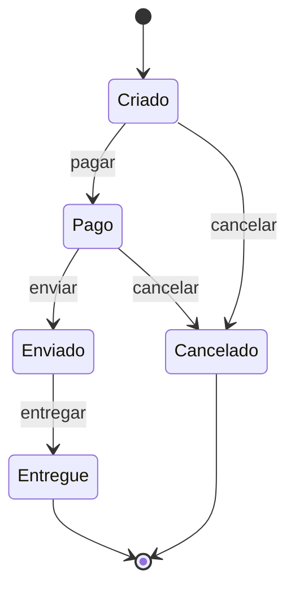

# ✍️ Exercícios K3 — CTFL v4.0.1

[English](k3-exercises.md) | **Português**

A prova tem **8 questões K3** (aplicar), todas nos capítulos 4 e 5. Cada exercício abaixo corresponde a um objetivo de aprendizagem K3 do syllabus v4.0.1. No fim há um bônus de caixa-branca, que é K2.

**Como usar:** tente resolver antes de abrir a resposta (▶ **Ver resposta**).

| # | Objetivo | Técnica |
|---|---|---|
| 1 | FL-4.2.1 | [Particionamento de equivalência](#1-particionamento-de-equivalência-fl-421) |
| 2 | FL-4.2.2 | [Análise de valor limite (2 e 3 valores)](#2-análise-de-valor-limite-fl-422) |
| 3 | FL-4.2.3 | [Tabela de decisão](#3-tabela-de-decisão-fl-423) |
| 4 | FL-4.2.4 | [Transição de estados](#4-transição-de-estados-fl-424) |
| 5 | FL-4.5.3 | [ATDD](#5-atdd-fl-453) |
| 6 | FL-5.1.4 | [Estimativa de esforço](#6-estimativa-de-esforço-fl-514) |
| 7 | FL-5.1.5 | [Priorização de casos de teste](#7-priorização-de-casos-de-teste-fl-515) |
| 8 | FL-5.5.1 | [Relatório de defeito](#8-relatório-de-defeito-fl-551) |
| ⭐ | FL-4.3.1 / 4.3.2 | [Bônus: cobertura de instrução e de ramo](#-bônus-cobertura-de-instrução-e-de-ramo-fl-431--432) |

---

## 1. Particionamento de equivalência (FL-4.2.1)

**1a.** Um cadastro aceita idades **inteiras de 18 a 65**. Quais são as partições e qual o número mínimo de casos de teste para 100% de cobertura?

<details>
<summary>▶ Ver resposta</summary>

| Partição | Valores | Tipo |
|---|---|---|
| P1 | ≤ 17 | inválida |
| P2 | 18 a 65 | válida |
| P3 | ≥ 66 | inválida |

**Mínimo: 3 casos de teste**, um valor de cada partição, por exemplo 10, 30 e 70.

A cobertura é o número de partições exercitadas dividido pelo total de partições: 3/3 = 100%. Partições inválidas devem ser testadas **isoladamente**, uma por caso de teste, para evitar o mascaramento de defeitos.
</details>

**1b.** Um checkout tem dois campos: **forma de pagamento** (PIX, cartão, boleto) e **tipo de cliente** (novo, recorrente). Qual o mínimo de casos de teste para cobertura **Each Choice**?

<details>
<summary>▶ Ver resposta</summary>

**3 casos de teste.** Each Choice exige que cada partição de cada conjunto apareça pelo menos uma vez, sem combinar todas. O maior conjunto tem 3 partições, então:

| Caso | Pagamento | Cliente |
|---|---|---|
| CT1 | PIX | novo |
| CT2 | cartão | recorrente |
| CT3 | boleto | novo (ou recorrente) |

Para testar **todas as combinações** seriam necessários 3 × 2 = 6 casos, mas isso não é exigido pela cobertura Each Choice.
</details>

---

## 2. Análise de valor limite (FL-4.2.2)

Mesmo campo do exercício 1a: idade inteira de **18 a 65**.

**2a.** Quais valores são necessários para 100% de cobertura com **BVA de 2 valores**?

<details>
<summary>▶ Ver resposta</summary>

Os **valores limite** são o mínimo e o máximo de cada partição: **17** (máximo de P1), **18** e **65** (P2) e **66** (mínimo de P3).

Na BVA de 2 valores, cada limite tem 2 itens de cobertura: ele mesmo e o vizinho mais próximo na partição adjacente. Como os vizinhos aqui também são limites, os itens de cobertura são **17, 18, 65 e 66**, ou seja, **4 valores**.
</details>

**2b.** E com **BVA de 3 valores**?

<details>
<summary>▶ Ver resposta</summary>

Na BVA de 3 valores, cada limite tem 3 itens de cobertura: ele mesmo e os **dois** vizinhos.

| Limite | Itens |
|---|---|
| 17 | 16, 17, 18 |
| 18 | 17, 18, 19 |
| 65 | 64, 65, 66 |
| 66 | 65, 66, 67 |

Sem repetições: **16, 17, 18, 19, 64, 65, 66, 67**, ou seja, **8 valores**.

A BVA de 3 valores é mais rigorosa. O syllabus dá este exemplo: se a decisão `if (x ≤ 10)` for implementada por engano como `if (x = 10)`, os valores da BVA de 2 valores (10 e 11) não detectam o defeito. Já o 9, que vem da BVA de 3 valores, detecta.
</details>

---

## 3. Tabela de decisão (FL-4.2.3)

**Regra de login:** se a conta estiver **bloqueada**, o sistema mostra "Conta bloqueada", independentemente da senha. Se não estiver bloqueada, a senha correta faz o login e a senha errada mostra "Senha inválida".

**3a.** Monte a tabela de decisão completa. **3b.** Minimize-a. Quantos casos de teste são necessários para 100% de cobertura da tabela minimizada?

<details>
<summary>▶ Ver resposta</summary>

**3a. Tabela completa** (2 condições → 2² = 4 regras):

| | R1 | R2 | R3 | R4 |
|---|:---:|:---:|:---:|:---:|
| **C1:** Conta bloqueada? | T | T | F | F |
| **C2:** Senha correta? | T | F | T | F |
| **A1:** Mostrar "Conta bloqueada" | X | X | | |
| **A2:** Fazer login | | | X | |
| **A3:** Mostrar "Senha inválida" | | | | X |

**3b. Tabela minimizada.** R1 e R2 têm a mesma ação e só diferem em C2, então C2 é irrelevante quando a conta está bloqueada ("–"):

| | R1 | R2 | R3 |
|---|:---:|:---:|:---:|
| **C1:** Conta bloqueada? | T | F | F |
| **C2:** Senha correta? | – | T | F |
| **A1:** Mostrar "Conta bloqueada" | X | | |
| **A2:** Fazer login | | X | |
| **A3:** Mostrar "Senha inválida" | | | X |

**3 casos de teste**, um por coluna viável. A cobertura é o número de colunas exercitadas dividido pelo total de colunas viáveis.
</details>

---

## 4. Transição de estados (FL-4.2.4)

**Ciclo de vida de um pedido:**



Cada caso de teste começa em **Criado**. Responda:

**4a.** Mínimo de casos de teste para 100% de cobertura de **todos os estados**?
**4b.** Mínimo para 100% de cobertura de **transições válidas (0-switch)**?
**4c.** Quantas **transições inválidas** existem na tabela de estados?

<details>
<summary>▶ Ver resposta</summary>

**4a. 2 casos.**
- CT1: Criado → Pago → Enviado → Entregue (4 estados).
- CT2: Criado → Cancelado (o 5º estado).

**4b. 3 casos.** São 5 transições válidas: pagar, cancelar (de Criado), enviar, cancelar (de Pago) e entregar. Como Entregue e Cancelado são estados finais, cada caso termina num deles:
- CT1: Criado →pagar→ Pago →enviar→ Enviado →entregar→ Entregue
- CT2: Criado →cancelar→ Cancelado
- CT3: Criado →pagar→ Pago →cancelar→ Cancelado

**4c. 15 transições inválidas.** A tabela de estados tem 5 estados × 4 eventos = 20 células. Dessas, 5 são válidas, então 20 − 5 = 15 são inválidas (por exemplo, "enviar" a partir de Criado).

| Estado \ Evento | pagar | cancelar | enviar | entregar |
|---|---|---|---|---|
| Criado | Pago | Cancelado | — | — |
| Pago | — | Cancelado | Enviado | — |
| Enviado | — | — | — | Entregue |
| Entregue | — | — | — | — |
| Cancelado | — | — | — | — |

Para cobertura de **todas as transições**, cada transição inválida deve ser tentada, de preferência **uma por caso de teste**, para evitar o mascaramento de defeitos.
</details>

---

## 5. ATDD (FL-4.5.3)

**História de usuário:** *Como cliente, quero aplicar um cupom de desconto no carrinho para pagar menos.*

**Critérios de aceite:**
- O cupom `PROMO10` dá 10% de desconto.
- Um cupom expirado mostra "Cupom expirado" e não altera o total.
- Só é possível aplicar um cupom por pedido.

Escreva os casos de teste de aceite no formato Dado/Quando/Então.

<details>
<summary>▶ Ver resposta</summary>

```gherkin
Cenário: Cupom válido aplica 10% de desconto
  Dado um carrinho com total de R$ 200,00
  Quando o cliente aplica o cupom "PROMO10"
  Então o total passa a ser R$ 180,00

Cenário: Cupom expirado não altera o total
  Dado um carrinho com total de R$ 200,00
  E o cupom "VERAO23" está expirado
  Quando o cliente aplica o cupom "VERAO23"
  Então o sistema mostra "Cupom expirado"
  E o total continua R$ 200,00

Cenário: Segundo cupom é recusado
  Dado um carrinho com o cupom "PROMO10" já aplicado
  Quando o cliente tenta aplicar outro cupom válido
  Então o segundo cupom não é aplicado
```

No ATDD, os testes são escritos **antes** da implementação, a partir dos critérios de aceite. Primeiro vêm os cenários positivos, depois os negativos, e cada critério deve ter pelo menos um teste.
</details>

---

## 6. Estimativa de esforço (FL-5.1.4)

**6a. Três pontos.** Os especialistas estimam o teste de uma funcionalidade em: otimista **a = 6**, mais provável **m = 12** e pessimista **b = 24** pessoas-hora. Calcule a estimativa e o desvio padrão.

<details>
<summary>▶ Ver resposta</summary>

- E = (a + 4m + b) / 6 = (6 + 48 + 24) / 6 = 78 / 6 = **13**
- DP = (b − a) / 6 = (24 − 6) / 6 = **3**

**Resultado: 13 ± 3 pessoas-hora**, ou seja, entre 10 e 16 pessoas-hora.
</details>

**6b. Proporções.** No projeto anterior, a proporção entre o esforço de desenvolvimento e o de teste foi **5:2**. O novo projeto prevê **500 pessoas-dia** de desenvolvimento. Qual a estimativa de teste?

<details>
<summary>▶ Ver resposta</summary>

500 × 2/5 = **200 pessoas-dia** de teste.
</details>

---

## 7. Priorização de casos de teste (FL-5.1.5)

| Caso | Prioridade (1 = mais alta) | Depende de |
|---|:---:|---|
| CT-A | 1 | CT-C |
| CT-B | 2 | — |
| CT-C | 3 | — |
| CT-D | 4 | CT-B |

Em que ordem os casos devem ser executados?

<details>
<summary>▶ Ver resposta</summary>

**CT-C → CT-A → CT-B → CT-D**

CT-A tem a prioridade mais alta, mas depende de CT-C, então CT-C precisa rodar antes, mesmo tendo prioridade menor. Em seguida vem CT-B, que é o próximo em prioridade. Por último vem CT-D, que depende de CT-B, já executado.
</details>

---

## 8. Relatório de defeito (FL-5.5.1)

Ao testar o cupom do exercício 5, você aplica `PROMO10` num carrinho de R$ 200,00 e o total vai para **R$ 190,00**. Escreva o relatório de defeito.

<details>
<summary>▶ Ver resposta</summary>

| Campo | Conteúdo |
|---|---|
| **ID** | BUG-042 |
| **Título** | Cupom PROMO10 aplica 5% de desconto em vez de 10% |
| **Data / autor** | 2026-11-14 — nome do testador (QA) |
| **Objeto e ambiente** | Carrinho, build 1.4.2, homologação, Chrome 130 |
| **Contexto** | Caso de teste CT-CUPOM-01 (ATDD, cenário "Cupom válido") |
| **Passos para reproduzir** | 1. Adicionar ao carrinho produtos no total de R$ 200,00 · 2. Aplicar o cupom PROMO10 |
| **Resultado esperado** | Total de R$ 180,00 |
| **Resultado obtido** | Total de R$ 190,00 |
| **Severidade** | Alta (impacto financeiro e na confiança do cliente) |
| **Prioridade** | Alta (a campanha começa na próxima semana) |
| **Status** | Aberto |
| **Referências** | História de usuário "Cupom de desconto", CT-CUPOM-01, print anexado |

Lembre: **severidade** é o grau de impacto, e **prioridade** é a urgência da correção. As duas são independentes.
</details>

---

## ⭐ Bônus: cobertura de instrução e de ramo (FL-4.3.1 / 4.3.2)

Este bônus é K2: a prova pede para **explicar** esses conceitos, não para calcular. Mesmo assim, o exemplo ajuda a fixar a diferença.

```javascript
function calcularFrete(valor, vip) {
  let frete = 20;          // instrução 1
  if (valor >= 200) {      // decisão 1
    frete = 0;             // instrução 2
  }
  if (vip) {               // decisão 2
    frete = frete / 2;     // instrução 3
  }
  return frete;            // instrução 4
}
```

**a)** Quantos testes são necessários para 100% de cobertura de **instrução**?
**b)** E para 100% de cobertura de **ramo**?

<details>
<summary>▶ Ver resposta</summary>

**a) 1 teste:** `calcularFrete(250, true)` passa pelas duas condições verdadeiras e executa todas as instruções.

**b) 2 testes:** cada decisão precisa sair pelo lado verdadeiro **e** pelo lado falso.
- `calcularFrete(250, true)` → decisão 1 verdadeira, decisão 2 verdadeira
- `calcularFrete(100, false)` → decisão 1 falsa, decisão 2 falsa

Isso mostra que **100% de cobertura de ramo garante 100% de instrução, mas não o contrário**: o teste único de (a) cobre todas as instruções e nenhum ramo falso.
</details>

---

📚 Veja também: [Guia por capítulo](chapter-guide.pt-BR.md) · [Glossário PT ↔ EN](glossary.md) · [README](../README.pt-BR.md)
